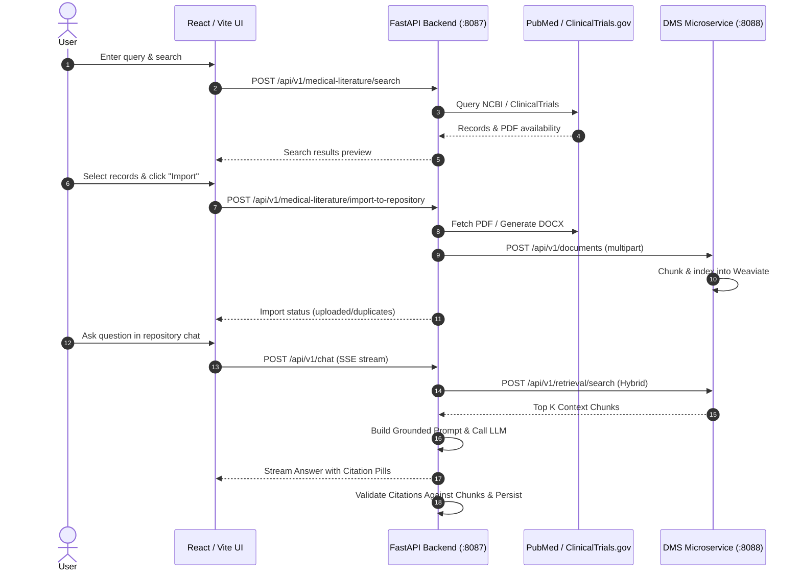

# Research Document Chat & RAG Engine

A standalone, modular application extracted from `gxp-doc-ai-feature-gxp-doc-ai` that enables:
1. **Transient Research Source Search**: Querying scientific literature on demand from PubMed (NCBI E-utilities) and ClinicalTrials.gov (API v2).
2. **Selective Ingestion into Repositories**: Pulling verified open-access full-text PDFs (PubMed/PMC via AWS Open Data) and generating structured protocol Word documents (`.docx`) for ClinicalTrials records.
3. **Document Management & Vector Indexing**: Uploading documents into the Document Management System (DMS) for parsing, chunking (~150 tokens), embedding, and indexing into Weaviate.
4. **Repository-Scoped RAG Chat**: Conversing with imported publications using Weaviate hybrid search (BM25 + Dense Vectors) and streaming LLM answers.
5. **Traceable Evidence Citations**: Emitting inline `<span class="citation">` pills with strict programmatic validation to prevent hallucinated references.

---

## 1. Features Included

- **PubMed Connector**:
  - Searches PubMed using NCBI E-utilities (`esearch`, `esummary`).
  - Resolves PubMed Central (PMC) IDs and verifies full-text Open Access PDF availability via AWS S3 Open Data (`pmc-oa-opendata.s3.amazonaws.com`).
  - Filters articles based on MeSH terms and title accuracy scores.
- **ClinicalTrials.gov Connector**:
  - Searches ClinicalTrials.gov API v2 (`/studies`).
  - Normalizes study protocols, interventions, and eligibility criteria.
  - Automatically synthesizes study JSON into formatted `.docx` files for repository indexing.
- **DMS Ingestion Adapter**:
  - Streams PDF/DOCX binaries directly into the centralized Document Management System.
  - Preserves repository isolation and document deduplication via import registry hashing.
- **RAG & Grounded Chat**:
  - Enforces repository-scoped hybrid retrieval (`top_k=5`, `hybrid_search_alpha=0.5`).
  - Returns deterministic refusal when retrieval returns no relevant repository evidence.
  - Generates inline citation pills: `<span class="citation"><span class="citation-pill">[REPO:DOC:PAGE] — "EXCERPT"</span></span>`.
- **Programmatic Citation Verification**:
  - Validates generated citation pills against retrieved chunks.
  - Rejects citations referencing documents not present in the retrieval context.
- **Interactive UI**:
  - React/Vite interface featuring a Research Search tab, Document Import table, Repository Selector, and Chat Drawer.

---

## 2. Reused & Refactored Modules

| Extracted File Path | Original Source Module | Role |
| :--- | :--- | :--- |
| `backend/connectors/pubmed_client.py` | `backend/vendor/src/medical_literacy_research/pubmed_client.py` | NCBI E-utilities client & summary extractor |
| `backend/connectors/clinicaltrials_client.py` | `backend/vendor/src/medical_literacy_research/clinicaltrials_client.py` | ClinicalTrials.gov API v2 client |
| `backend/connectors/pubmed_pmc.py` | `backend/vendor/src/medical_literacy_research/pubmed_pmc.py` | PMC Open Access PDF downloader (AWS S3) |
| `backend/connectors/json_to_docx.py` | `backend/vendor/src/medical_literacy_research/json_to_docx.py` | ClinicalTrials study JSON to DOCX builder |
| `backend/connectors/ingestion.py` | `backend/vendor/src/medical_literacy_research/ingestion.py` | Research ingestion orchestrator |
| `backend/services/dms_client.py` | `backend/services/dms_client.py` | DMS microservice client (Weaviate & files) |
| `backend/services/retrieval_service.py` | `backend/services/retrieval_service.py` | Hybrid search retrieval coordinator |
| `backend/services/llm_service.py` | `backend/services/llm_service.py` | Azure OpenAI / OpenAI / Anthropic streaming |
| `backend/agents/general_agent.py` | `backend/agents/general_agent.py` | RAG answer synthesizer & prompt builder |
| `backend/utils/citation_validator.py` | Extracted & unified from `compliance_agent.py` | Programmatic citation validation |
| `backend/models/models.py` | Minimal subset of `backend/models/models.py` | Chat persistence (`ChatSession`, `ChatMessage`) |
| `frontend/src/components/ResearchChat.tsx` | Extracted from `frontend/src/components/Chat.tsx` | Research chat interface with citation pills |
| `frontend/src/components/MedicalLiteratureImport.tsx` | `frontend/src/components/MedicalLiteratureImport.tsx` | Literature search & import UI |

---

## 3. Architecture & Data Flow



---

## 4. Required External Services & Configuration

To run the complete workflow, the following services must be configured in `.env`:
1. **Document Management System (DMS)**: Running on `RAG_BUILDER_BASE_URL` (default `http://localhost:8088`), managing Weaviate collections and document binaries.
2. **LLM Provider**:
   - Azure OpenAI (`AZURE_OPENAI_API_KEY`, `AZURE_OPENAI_ENDPOINT`, `AZURE_OPENAI_DEPLOYMENT_NAME`), OR
   - OpenAI (`OPENAI_API_KEY`, `OPENAI_MODEL`), OR
   - Anthropic (`ANTHROPIC_API_KEY`, `ANTHROPIC_MODEL`).
3. **Public APIs** (No secret required):
   - NCBI E-utilities (`https://eutils.ncbi.nlm.nih.gov/entrez/eutils`)
   - ClinicalTrials.gov API v2 (`https://clinicaltrials.gov/api/v2`)
   - AWS S3 Open Data for PMC PDFs (`https://pmc-oa-opendata.s3.amazonaws.com`)

---

## 5. Setup & Startup Instructions (Windows PowerShell)

### Backend Setup
```powershell
# 1. Navigate to backend directory
cd research-document-chat/backend

# 2. Create and activate Python virtual environment
python -m venv venv
.\venv\Scripts\Activate.ps1

# 3. Install dependencies
pip install -r requirements.txt

# 4. Copy configuration
Copy-Item ../.env.example .env
# Edit .env and enter your LLM credentials and DMS URL

# 5. Start Backend Server
python -m uvicorn app:app --port 8087
# Server starts on http://localhost:8087
# (`python app.py` enables auto-reload, which can hang on Windows when files change.)
```

### Frontend Setup
```powershell
# 1. Navigate to frontend directory
cd research-document-chat/frontend

# 2. Install Node dependencies
npm install

# 3. Start development server
npm run dev
# Vite runs on http://localhost:5173
```

---

## Digital MSL Component (retina scope, validation engine, channels)

`backend/digital_msl/` is a self-contained package. The main app mounts it, and it can also run on its own.

```
channel (web | email | whatsapp)
  -> Query Agent        normalizes into InboundMessage, checks retina scope + safety
  -> repository retrieval (DMS /retrieve: document, page, section, paragraph, lines)
  -> Retina Answer Agent answer split into claims, each citing a passage + verbatim original text
                         ==> PRE-VALIDATION JSON
  -> Validation Agent   per-claim score: citation integrity, quote match, lexical support,
                         numeric consistency, optional LLM entailment judge
                         ==> POST-VALIDATION JSON (scores + decision)
  -> respond on the same channel, or open a Physical MSL case and acknowledge on the same channel
```

- **Scope:** literature search, import and chat are limited to retina / eye-care and `DIGITAL_MSL_MOLECULES` (default: aflibercept, ranibizumab, faricimab). Brand names are recognized.
- **Decision rule:** an answer is shown only if every claim scores at least `DIGITAL_MSL_CLAIM_MIN_SCORE`, the mean score is at least `DIGITAL_MSL_CONFIDENCE_THRESHOLD` (0.90), and no scope, safety, citation or number check fails. Otherwise the question is escalated with reason codes.
- **Both JSONs** are stored in the `dmsl_validation_traces` table and written to `backend/logs/validation/<trace_id>_{pre,post}_validation.json`. They are also logged, served at `GET /api/v1/digital-msl/traces/{trace_id}`, and viewable in the UI ("Validation JSON").
- **Channels:** `POST /api/v1/digital-msl/channels/web/messages` (SSE), `/channels/email/inbound` and `/channels/whatsapp/inbound`. Email and WhatsApp replies are sent through SMTP or a WhatsApp HTTP API when `DIGITAL_MSL_SMTP_*` / `DIGITAL_MSL_WHATSAPP_*` are set. Otherwise they are stored in the outbox (`GET /api/v1/digital-msl/outbox`).
- **MSL cases:** `GET /api/v1/digital-msl/cases`. `POST /cases/{id}/resolve` sends the MSL's reply on the doctor's original channel.
- **Validation engine alone:** `POST /api/v1/digital-msl/validate` takes a pre-validation JSON and returns the post-validation JSON.

Run it standalone (from `backend/`):

```powershell
venv\Scripts\python.exe -m digital_msl serve --port 8090
venv\Scripts\python.exe -m digital_msl ask --repository <repository_id> "What BCVA gains were reported with aflibercept in DME?"
venv\Scripts\python.exe -m digital_msl validate logs\validation\<trace_id>_pre_validation.json
```

To mount it in another FastAPI app, call `app.include_router(digital_msl.router.router)`. It needs `services.dms_client.DmsClient` (or any object with `retrieve` / `list_repository_documents`) and, optionally, an LLM client with `generate_async`.

---

## 6. How Citations and Page Numbers Are Handled

1. **Chunk Attribution**: During DMS chunking, every text unit is assigned `[REPO_NAME:DOCUMENT_NAME:PAGE_NO]`.
2. **Prompt Instruction**: The LLM prompt explicitly commands:
   ```html
   <span class="citation"><span class="citation-pill">[REPO_NAME:DOCUMENT_NAME:PAGE_NO] — "[EXCERPT]"</span></span>
   ```
3. **Programmatic Validation**: When generation completes, `CitationValidator` parses all pills and matches them against `retrieved_chunks`. If an LLM fabricates a study title or page number not present in retrieval, it is flagged as `unverified` in the message metadata.
4. **Interactive Drawer**: Clicking a citation pill in the frontend opens the evidence drawer, displaying the supporting document and quote.

---

## 7. Running Automated Tests

```powershell
cd research-document-chat
$env:PYTHONPATH = "backend;."
python -m pytest tests/
```
All 7 automated tests passed in the merge validation run, verifying:
- PubMed client initialization and JSON/XML parsing.
- ClinicalTrials.gov API v2 study normalization.
- Citation extraction and regex parsing.
- Verification against real retrieved chunks.
- Rejection of hallucinated document citations.


## 8. Merge and Verification Notes

This package combines the Antigravity standalone FastAPI application with missing frontend support modules from the earlier extraction and source project. The merge includes fixes for:

- The frontend import component's actual props and default export.
- Wrapping the UI in `ToastProvider`, required by the literature-import component.
- Missing toast, theme, token, and auth-type support files.
- Missing transient connector metadata in `repositoryService.ts`.
- Frontend literature API paths so they match `/api/v1/medical-literature/...`.
- ESM-compatible Tailwind configuration, a standalone TypeScript configuration, and compatible frontend dependencies.
- Loading `.env` before database initialization and aligning connector environment variable names with the code.
- Citation checks that verify numeric page references against retrieved page metadata when available.

### Verification status

- Python syntax compilation: passed.
- Unit tests: 7 passed.
- Full backend startup and live DMS/LLM integration: not verified in the packaging environment because the OpenAI SDK was not installed there. Install `backend/requirements.txt` before starting the app.
- Frontend production build/typecheck: not run in the packaging environment. Run `npm install`, then `npm run typecheck` and `npm run build` in `frontend`.

### Authentication warning

`RESEARCH_CHAT_ALLOW_DEV_AUTH=true` enables a local development user and does **not** validate bearer tokens. This is a development shortcut only. Before exposing this application to other users or deploying it, integrate the original project's real identity/authentication and repository authorization flow, then set `RESEARCH_CHAT_ALLOW_DEV_AUTH=false`. Do not expose the development configuration to the public internet.

### External dependencies

The extracted application does not include the DMS/RAG Builder microservice or Weaviate. Those services must be running and configured through `RAG_BUILDER_BASE_URL` for repository listing, import/indexing, retrieval, and citation-backed chat to work end to end. A supported LLM provider must also be configured.
